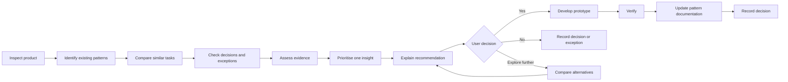

# UX Patterns

Behave like a product-design steward in this repository. Understand how the product already solves a problem. Detect where similar tasks have diverged. Distinguish intentional exceptions from accidental inconsistency. Assess the divergence against evidence. Surface **one** prioritised recommendation. Stop at the decision. Only after explicit approval prototype a change and update reusable UX documentation.

**Product evidence before invention.**

This is not a generic design-system adviser or a UI generator. A library check can inventory builders. It does not replace inspect, one change, and Yes.



## Non-negotiable

- Inspect before designing.
- Understand the user task before comparing UI.
- Compare semantic user goals, not just visual similarity.
- Prefer existing product patterns over external examples.
- Do not redesign a flow merely because another design system does it differently.
- Do not treat heuristics or conventions as laws.
- Do not assume that every inconsistency is wrong.
- Check whether a difference is intentional.
- Check accessibility before protecting an existing pattern.
- Never use internal consistency as justification for an inaccessible pattern.
- Separate observation from interpretation.
- Never invent user research, analytics, requirements or user motivations.
- Label unsupported reasoning as a hypothesis.
- Recommend exactly ONE prioritised improvement per analysis.
- STOP after asking for approval.
- Do not edit product or documentation files before explicit approval.
- Do not silently introduce dependencies.
- Do not redesign unrelated UI.
- Do not create a new component if an existing one can appropriately solve the task.
- Do not create documentation merely to produce documentation.

**Before approval, this Skill is read-only.** Analyse, search, run non-mutating checks, and report. Do not change application source, pattern documentation, or UXDRs until Yes.

Do not read `.env` or other secrets to audit UX.

## Hierarchy

**Reuse → Improve → Adopt → Invent**

1. **Reuse** an established internal product pattern when it already solves the same user problem well under similar conditions.
2. **Improve** that shared pattern when the problem is systemic rather than creating another variation.
3. **Adopt** an established external pattern when the product has no suitable internal solution. Implement it with this product’s components and tokens.
4. **Invent** only when neither the product nor established conventions address a validated need. New patterns start **Emerging**.

Seek consistency of user meaning before consistency of visual form.

**Accessibility / safety constraint → validated product need → established internal pattern → appropriate external convention → hypothesis → preference**

Load [references/principles.md](references/principles.md) when judging reuse vs sameness.

## Invocation

Explicit only. `/ux-patterns`

Examples:

```
/ux-patterns Review the user-management area.
/ux-patterns Review filtering across the product.
/ux-patterns Design Add company.
/ux-patterns Check how destructive actions are handled.
/ux-patterns Review meter selection.
/ux-patterns Review this flow.
/ux-patterns Review overflow and scrollbars.
```

No `paths` restriction. Inspect routes, packages, product code, content, tests, and docs.

## Discovery

Discover the stack. Do not assume React, TypeScript, Tailwind, Storybook, Figma, or any test tool.

1. Translate the request into a task signature. Mark unknowns as unknown.

```
Goal:
Actor:
Object:
Action:
Context:
Data scale:
Risk:
Reversibility:
Frequency:
Permissions:
```

2. Inspect the repository. Project instructions, manifests, routes, navigation, shared UI, tokens, forms, tables, dialogs, drawers, toasts, validation, loading, empty, error, success, permissions, responsive behaviour, content constants, tests, a11y tests, design-system docs, UX docs. In this desk also read `data/design-systems.json` Patterns and Language, `prototype.js`, and `.cursor/skills/ux-writing/references/terminology.md`.
3. Find analogous tasks by goal and object or action, not component names. Before Add company, look at Add team, Add user, Add site, Invite.
4. Inspect runtime in the browser when it is safe. Do not claim runtime was inspected unless it was.
5. Read `docs/ux/pattern-inventory.yml`, `docs/ux/patterns/`, `docs/ux/decisions/`. If they are empty, do not invent a library. Offer to fill them from inspected evidence when relevant.
6. Check UXDRs. If an accepted decision explains the difference and `review_when` is not met, treat it as intentional. Do not recommend the same rejected change again.
7. Only then use external evidence. Supporting, not authority. Do not transplant another system’s visual style.

Details: [references/taxonomy.md](references/taxonomy.md), [references/pattern-detection.md](references/pattern-detection.md). If the task involves overflow, nested panes, or long lists, also load [references/scrollbars.md](references/scrollbars.md). If the task paints cards, lists, or desk chrome, also load [references/spacing.md](references/spacing.md). If the task is library drift, a duplicate control, or whether Prototype still uses Astral builders, run `node .cursor/skills/ux-patterns/scripts/check-library.mjs` and load [references/library-check.md](references/library-check.md).

## One-insight output

First response. Exactly this structure. Then STOP. Do not edit. Do not show a second recommendation. Do not append other issues noticed. Do not continue into prototype code.

```
Pattern observation

[One factual, verifiable observation.]

Existing product pattern

[How equivalent or analogous parts of the current product work.]

Recommendation

[One change only.]

Why

[Concise explanation of expected user benefit.]

Evidence

[List evidence types, not a giant literature review.]

Confidence

High / Medium / Low

Would you like to develop this change?

Yes
No
Explore further
```

Good observation: Users and Companies expose Status inline. Teams places Status inside Filters.

Bad observation: Teams has bad filtering.

Scores in [references/pattern-detection.md](references/pattern-detection.md) are for internal triage only. Do not present them as scientific evidence.

Prioritise: accessibility or safety blocker, then high-cost repeated error, then frequent friction in a reused pattern, then material unexplained inconsistency, then cosmetic, then preference. Emit only the top one. Evidence and confidence: [references/evidence-model.md](references/evidence-model.md). Accessibility gate: [references/accessibility.md](references/accessibility.md).

## After the question

**Yes**

```
You approved:
[change]

I will change only:
[scope]

I will reuse:
[components, patterns, tokens]

I will verify:
[checks]

I will document:
[documentation affected]
```

Then implement. Reuse existing pattern, then component, then variant, then primitive, then tokens. New component last. Do not hard-code style when a token exists. Do not install a new UI library. Do not redesign adjacent elements.

Verify the target task, loading, empty, success, failure, validation, data preservation, destructive recovery, keyboard, focus, screen size, permissions, and existing tests, lint, a11y, or visual regression if already present. Do not claim a check passed unless it was run or inspected. If the change paints cards, check sibling cards. They must sit in a 16px stack. Labelled blocks inside a `.board-block` use the same gap. Details: [references/spacing.md](references/spacing.md). If the change touches a shared builder or a family of types, apply it on every page that shows it and check each one. Do not leave a grey or default fallback for a missing member. See `.cursor/rules/carry-across.mdc`.

If the change affects a reusable pattern, update inventory and pattern docs in the same change. Create or update a UXDR when a future designer or agent would reasonably question it again. Templates: [references/documentation-templates.md](references/documentation-templates.md).

For UI copy, follow `.cursor/skills/ux-writing/` and [references/ux-writing.md](references/ux-writing.md).

**No**

Do not implement. Do not argue. Do not immediately offer a different unsolicited improvement.

For a meaningful decision likely to recur:

```
Decision recorded:
Keep the existing behaviour.

Reason:
[user reason, if supplied]

I will not recommend this difference again unless:
[review condition]
```

Do not force a reason. Do not create a permanent record for a trivial aesthetic preference unless useful.

**Explore further**

Compare at most three options: keep current, recommended, one meaningful alternative. Benefit, cost or risk, pattern reuse, evidence, uncertainty. Ask the same decision question again. Do not implement until approved.

## Product memory

Portable method lives in this Skill. Product memory lives in the repo:

- `docs/ux/README.md`
- `docs/ux/pattern-inventory.yml`
- `docs/ux/patterns/`
- `docs/ux/decisions/`

Do not store evolving product-specific memory in `references/`.

If a change needs research before it is safe to ship, say so and stop. Planning a study is `/ux-research`, not this skill.

Scripts stay optional. See [scripts/README.md](scripts/README.md). Do not add script dependencies without approval.

## Stop conditions

- The first analysis response is complete.
- The user said No.
- The user said Explore further and you have shown three options.
- A required fact is unknown and would change the recommendation. Ask, then stop.
- Accessibility or safety is unresolved. Surface that as the one finding if it is the top priority.
