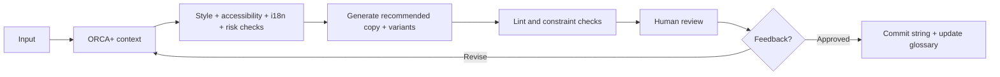

# ORCA+ UX writing

Use ORCA to understand meaning before choosing words. ORCA is Objects, Relationships, Calls-to-Action and Attributes. It is a semantic context model, not the writing method. Combine it with plain language, accessibility, localization and content-design practice. Do not treat ORCA as enough on its own.

ORCA+ adds role, intent, state, surface, locale and risk. Those six rows are not official ORCA. They turn capabilities and conditions into facts a writing agent can use.

Default voice is short, literal, globally understandable **en-GB-oxendict**. Sentence case. On Home metric cards the supporting line under the figure starts with a capital letter. Action-led CTAs. One term for one concept. Errors explain, they do not blame. Treat CEFR A2–B1 as a language-complexity heuristic, not a claimed score.

Do not write Add team, Add company or Grant access until the current object, actor and scope are known.

Optimize for the shortest copy that keeps the object, action, scope, consequence and recovery. Do not shave characters if that drops meaning.

Load [references/style-guide.md](references/style-guide.md), [references/terminology.md](references/terminology.md), [references/templates.md](references/templates.md), [references/localization.md](references/localization.md) and [references/accessibility-privacy.md](references/accessibility-privacy.md) only when that file is needed. Run `python3 .cursor/skills/ux-writing/scripts/check-copy.py` on proposed strings when linting length, glossary clashes or flagged phrases. Use `--kind card-sub` for the supporting line on a Home metric card.

## When to use

- `/ux-writing`
- Labels, CTAs, errors, success, empty states, onboarding, tooltips, help, notifications, permissions, modals
- Copy audits of Astral, the library, or Language entries

Do not use this skill to invent product behaviour, roles, lawful bases or retention periods. Product facts come from talks, `data/design-systems.json` Language, Access, and [references/terminology.md](references/terminology.md). The glossary outranks generic language guidance. For interaction recipes, reuse vs invention, and unexplained divergence, use `.cursor/skills/ux-patterns/` (`/ux-patterns`) before writing new copy for a new flow.

## ORCA+ before any string

| Layer | Question | Example |
| --- | --- | --- |
| Object | What thing is the copy about? | Team |
| Relationship | Where does it belong? | Team belongs to a company |
| CTA | What can the user do? | Add team |
| Attributes | What information or state matters? | Name, department, members |
| Role | Who is acting? | Company admin |
| Intent | What are they trying to achieve? | Organize company users |
| State | What has happened or is happening? | New, saving, failed, empty |
| Surface | Where will the copy appear? | Modal |
| Locale | What linguistic and formatting conventions apply? | en-GB-oxendict |
| Risk | Is the action destructive, permission-related or privacy-sensitive? | Grants access |

Distinguish object hierarchy from permission hierarchy. Do not infer that broker means Viewer. Accept the role and the actual capability map as input.

Infer harmless omissions. Stop only when a missing fact would change meaning, permissions, destructive consequences or privacy or legal interpretation.

## Input

Natural language:

```
/ux-writing
Write the Add team modal for a company admin.
They are inside Scottish Water.
Required fields: team name.
Members can be added later.
```

Or structured:

```yaml
surface: modal
object: team
relationship: company > team
role: company-admin
intent: create
state: default
copy_needed:
  - title
  - labels
  - help_text
  - primary_cta
  - secondary_cta
locale: en-GB-oxendict
constraints:
  primary_cta_chars: 24
legal_sensitive: false
known_terms:
  - company
  - team
  - member
```

## Voice

Default voice:

- clear, calm, direct and human
- specific and informative, never chatty for its own sake
- A2–B1-like linguistic complexity as a heuristic, not a claimed CEFR score
- active voice where clearer
- second person where it helps
- sentence case
- culturally neutral
- no humour in errors, destructive actions, permissions or privacy copy

One stable voice. Adjust only warmth or formality. Do not invent separate professional, friendly, fun or corporate voices.

Prefer: use, add, remove, change, save, send, view, choose, start, help, need, can, try again.

FLAG OR REWRITE: utilize, commence, in order to, please note, simply, obviously, easily, just, oops, forbidden, illegal, generic "Something went wrong", generic "Click here", and vague "valid/invalid" errors where the actual constraint is known.

## Hard rules

1. Locale is en-GB-oxendict. organize, organization, localization, prioritize. colour, behaviour, centre, licence. analyse, analysis.
2. Product terms stay exact. Do not swap Export, Download, Extract and Retrieve for variety.
3. Buttons normally begin with a clear verb and name the action. Avoid generic Continue or Next when a more specific action is known.
4. Soft budgets. Warn rather than truncate. See [references/style-guide.md](references/style-guide.md).
5. Errors state what happened or what needs attention, then how to recover when known. Do not blame. Preserve the field label.
6. Accessibility copy follows [references/accessibility-privacy.md](references/accessibility-privacy.md). Placeholder is not the only label. Do not rely on colour or icons alone. Do not say click the button on the right.
7. Localization follows [references/localization.md](references/localization.md). No concatenation. Named placeholders. CLDR plurals. No baked dates such as 09/10/26.
8. Privacy. Do not claim GDPR compliant or secure unless verified. Do not invent a lawful basis. Do not call something consent unless the supplied product or legal context says consent is the lawful basis. Never use "By continuing, you agree..." as a substitute for optional consent. When material facts are absent, output `LEGAL REVIEW REQUIRED: <missing fact>` instead of fabricating reassuring copy.
9. Astral product UI copy uses full stops, not colons, semicolons or em dashes. Shared library copy stays work-facing. No Uber, no Base Gallery, no desk names.
10. Do not store a password or a code.
11. On Home metric cards, the supporting line under the figure starts with a capital letter. Sentence case, not title case. Sites need action today. If the line starts with a number, do not capitalise the next word. 3.1 percent below last year.

## Output

For normal requests:

```
Recommended
Title: Add team
Team name
Company
Primary: Add team
Secondary: Cancel

Optional help text
Teams group people who need similar access.

Checks
✓ en-GB-oxendict
✓ terminology
✓ accessibility
✓ localization
✓ within length budgets
✓ no legal-sensitive wording
```

Keep rationale to one sentence unless the user asks for analysis.

Variants only when requested or genuinely useful:

```
Variants

Short:
Add team

Formal:
Create team

Informal:
Add team

Recommendation:
Add team — it matches the product object and is the clearest action.
```

For privacy or permissions, separate writing quality from product or legal truth:

```
Recommended
Allow Acme Energy to view Scottish Water data until 30 September 2027

Primary: Allow access
Secondary: Do not allow

Review
⚠ Confirm that consent is the documented lawful basis.
⚠ Confirm data scope and expiry date.
```

Copy audits:

```
Current | Issue | Recommended | Reason | Severity
```

For multiple tone options, use a comparison table. For templates, use a template table. For localization reviews, use a localization-considerations table.

When applying copy into the product or library, write the strings into the files. Then show the same Recommended and Checks block so the change is reviewable.

## Workflow



1. Fill ORCA+.
2. Read terminology, then the other references that apply.
3. Generate recommended copy from [references/templates.md](references/templates.md).
4. Lint with `python3 .cursor/skills/ux-writing/scripts/check-copy.py`.
5. Recommend tests. Do not claim the copy is proven.

## Feedback

When the user rejects or edits copy:

1. Identify the principle behind their preference.
2. Update the current recommendation.
3. Suggest a glossary or style-rule change if the preference should become systematic.
4. Do not silently generalize a one-off preference into a global rule.

## Testing

Recommend the check that fits. Do not treat lint as proof that users understand the terms.

| Test | Use it for | Do not treat it as |
| --- | --- | --- |
| Terminology lint | Finding inconsistent object and action names | Proof that users understand the terms |
| Length check | Catching likely layout pressure | Licence to truncate translations |
| Pseudolocalization | Expansion, missing externalization, layout and bidi issues | Translation quality assessment |
| Readability metric | Longer onboarding or help text | A reliable score for two-word UI labels |
| Accessibility review | Labels, instructions, error and status communication | Something solved by copy alone |
| Localization QA | Translation meaning, layout, formatting, context | Simple spell-checking |
| Usability testing | Whether users understand labels and tasks | A typography-only review |
| A/B test | Comparing meaningful alternatives against a behavioural outcome | A way to determine legal validity or accessibility compliance |

Do not use A/B testing to determine legal validity or accessibility compliance. For core object names such as Company, Team or Report, consistency and comprehension research matter more than a small click-through increase.

## Worked examples

### Add company modal for a platform admin

ORCA+. Object company. Relationship platform admin adds a company. CTA Add a company. Attributes type is Customer, Supplier, or Broker / TPI. Role Super admin on Platform admin. Intent add an organisation. State default. Surface modal on Companies. Locale en-GB-oxendict. Risk permission. Do not invent extra fields. Add a team stays on Users.

```
Recommended
Title: Add company
Company name
Type
Primary: Add company
Secondary: Cancel

Optional help text
Type is Customer, Supplier, or Broker / TPI. Third party is a relationship, not a type.

Checks
✓ object is company, not team
✓ Super admin on Platform admin
✓ no Grant access
```

### Add team modal for a company admin

ORCA+. Object team. Relationship company then team. CTA Add team. Attributes team name, company, people. Role Admin or Manager in that company. Intent organize people. State default. Surface modal. Risk none beyond access grouping. Permission user groups stay in admin.

```
Recommended
Title: Add team
Team name
Company
Primary: Add team
Secondary: Cancel

Optional help text
Then pick the people.

Checks
✓ company context is already established for a company admin
✓ Add team, not Add company
```

### Third-party access expiry

ORCA+. Object third-party access on the link to a customer. Relationship Broker / TPI or another company to a customer. CTA none unless they can change the link. Attributes company, scope, end date. Role the person viewing the link. State active or ended. Surface notice or person detail. Risk permission and personal data. Do not call this consent unless legal says so. Broker / TPI access is Viewer. They must not see data outside the period.

If actor, scope and date are supplied:

```
Recommended
Acme Energy can view Scottish Water data until 30 September 2027.

If access has ended
Your access to Scottish Water ended on 30 September 2027.

Review
⚠ Do not label this consent unless that is the documented lawful basis.
⚠ Confirm scope and date from the product, do not invent them.
```

If those facts are missing:

```
LEGAL REVIEW REQUIRED: actor, data scope and end date
```
